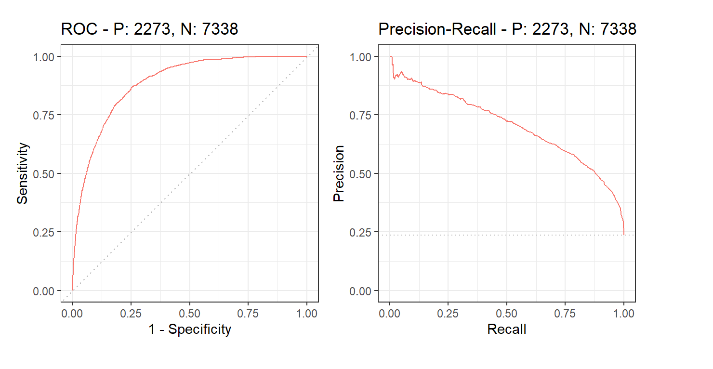

# m6APrediction

## Overview

**m6APrediction** is an R package designed to predict N6-methyladenosine (m6A) modification sites using a pre-trained Random Forest machine learning model.

The package uses several sequence-related features, including:

- GC content
- RNA type
- RNA region
- Exon length
- Distance to the nearest junction
- Evolutionary conservation
- DNA 5-mer sequence information

The package provides two main prediction functions:

- `prediction_multiple()`: Predicts m6A probabilities and classification statuses for multiple input samples.
- `prediction_single()`: Predicts the m6A probability and classification status for an individual input sample.

## Installation

The package can be installed from GitHub using `devtools`:

``` r
# Install devtools if necessary
install.packages("devtools")

# Install m6APrediction from GitHub
devtools::install_github("YOUR_GITHUB_USERNAME/m6APrediction")
```

Replace `YOUR_GITHUB_USERNAME` with your actual GitHub username.

## Usage

### 1. Load the package and example data

``` r
library(m6APrediction)

# Load the pre-trained Random Forest model
model_path <- system.file(
  "extdata", "rf_fit.rds",
  package = "m6APrediction"
)

rf_fit <- readRDS(model_path)

# Load example input data
data_path <- system.file(
  "extdata", "m6A_input_example.csv",
  package = "m6APrediction"
)

example_data <- read.csv(data_path)
```

### 2. Multiple-sample prediction

The `prediction_multiple()` function predicts m6A probabilities and classification statuses for multiple input samples.

``` r
multiple_results <- prediction_multiple(
  ml_fit = rf_fit,
  feature_df = example_data
)

# View prediction results
head(multiple_results)

# Count positive and negative predictions
table(multiple_results$predicted_m6A_status)
```

The output contains all original input features and two additional columns:

- `predicted_m6A_prob`: Predicted probability of m6A modification.
- `predicted_m6A_status`: Predicted classification (Positive or Negative).

### 3. Single-sample prediction

The `prediction_single()` function predicts the m6A probability and classification status for an individual input sample.

``` r
single_result <- prediction_single(
  ml_fit = rf_fit,
  gc_content = example_data$gc_content[1],
  RNA_type = as.character(example_data$RNA_type[1]),
  RNA_region = as.character(example_data$RNA_region[1]),
  exon_length = example_data$exon_length[1],
  distance_to_junction = example_data$distance_to_junction[1],
  evolutionary_conservation = example_data$evolutionary_conservation[1],
  DNA_5mer = as.character(example_data$DNA_5mer[1])
)

print(single_result)
```

The function returns a named vector containing:

- `predicted_m6A_prob`: Predicted probability of m6A modification.
- `predicted_m6A_status`: Predicted classification (Positive or Negative).

## Input Requirements

The input data must contain the following seven features:

- `gc_content`
- `RNA_type`
- `RNA_region`
- `exon_length`
- `distance_to_junction`
- `evolutionary_conservation`
- `DNA_5mer`

Additional requirements:

- `exon_length` and `distance_to_junction` should be log2-transformed.
- `DNA_5mer` must contain five nucleotides, with A at the central position.
- Supported RNA types are mRNA, lincRNA, lncRNA and pseudogene.
- Supported RNA regions are CDS, intron, 3'UTR and 5'UTR.

The default classification threshold is 0.5. Samples with predicted probabilities greater than the threshold are classified as Positive.

## Model Information

The package includes a pre-trained Random Forest model (`rf_fit.rds`) and an example dataset (`m6A_input_example.csv`) containing 100 observations.

These resources are stored in the `inst/extdata` directory and can be accessed using `system.file()` after installation.

## Model Performance

The following ROC and Precision-Recall (PRC) curves illustrate the performance of the Random Forest model.



## License

This package is distributed under the MIT License.
